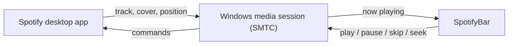

# SpotifyBar

**A tiny Spotify mini-player that lives right on your Windows 11 taskbar.**

See what's playing, pause, skip, and scrub through the track without ever opening the Spotify window.


<p align="center">
  
  &nbsp;&nbsp;
  
</p>

## Features

- **Now playing at a glance**: title, artist, and round album art, right next to the system tray.
- **Progress ring**: playback progress is drawn as a ring around the cover.
- **Playback controls**: previous, play / pause, and next.
- **Seeking**: click anywhere on the ring to jump to that point, or scroll the mouse wheel over the widget to move ±5 seconds.
- **Looks native**: a translucent pill that blends into the taskbar and highlights on hover like the taskbar's own buttons.
- **Stays out of the way**: hides automatically when a fullscreen game or video is in front, and comes back the moment the taskbar shows up (Start, tray, search).
- **No setup**: no Spotify API keys, no login, and no Premium needed.
- **Lightweight**: one small window with no taskbar button and no Alt+Tab entry. It never steals focus.

## How it works

Spotify's desktop app publishes its playback state to Windows through the
[System Media Transport Controls](https://learn.microsoft.com/uwp/api/windows.media.control) (SMTC), the same thing that powers the media flyout when you press a volume key.
SpotifyBar reads that session and sends commands back through it, so everything stays local to your PC.



Spotify only reports its position now and then, so SpotifyBar fills in the gaps between updates to keep the ring moving smoothly.
A window-event hook keeps the widget above the taskbar as soon as focus changes.

## Requirements

- Windows 10 version 2004 or later, or Windows 11
- [.NET 10 Desktop Runtime](https://dotnet.microsoft.com/download/dotnet/10.0)
- The Spotify desktop app

## Install

Build and install to `%LOCALAPPDATA%\Programs\SpotifyBar`:

```powershell
git clone https://github.com/<your-username>/SpotifyBar.git
cd SpotifyBar
dotnet publish -c Release -r win-x64 --no-self-contained -p:PublishSingleFile=true -p:DebugType=none -o "$env:LOCALAPPDATA\Programs\SpotifyBar"
& "$env:LOCALAPPDATA\Programs\SpotifyBar\SpotifyBar.exe"
```

To start it with Windows, right-click the widget and check **Запускати з Windows** ("Start with Windows").

## Usage

| Action | How |
| --- | --- |
| Play / pause | Click the white button |
| Previous / next track | Click the arrows |
| Jump to a point in the track | Click on the progress ring (12 o'clock is the start) |
| Seek ±5 seconds | Scroll the mouse wheel over the widget |
| See elapsed / total time | Hover over the ring |
| Move the widget | Drag it anywhere. The position is remembered. |
| Menu: autostart, reset position, exit | Right-click the widget |

The context menu and status text are in Ukrainian.

## Project layout

| File | What's inside |
| --- | --- |
| `MainWindow.xaml` | The pill layout: cover, progress ring, title, buttons |
| `MainWindow.xaml.cs` | SMTC session handling, seeking, positioning, fullscreen detection, autostart |
| `App.xaml` | Round icon button styles and single-instance guard |

Settings are stored in `%APPDATA%\SpotifyBar\position.txt` (widget position) and in the
`HKCU\Software\Microsoft\Windows\CurrentVersion\Run` registry key (autostart).

## License

[MIT](LICENSE)
