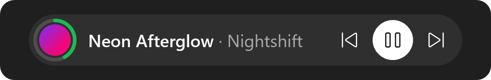
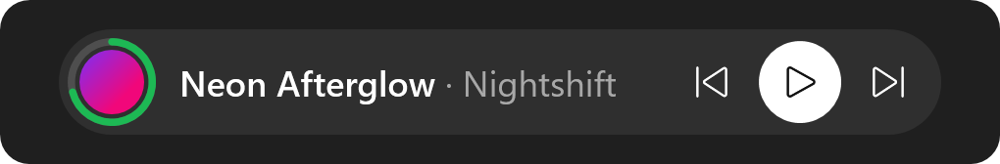
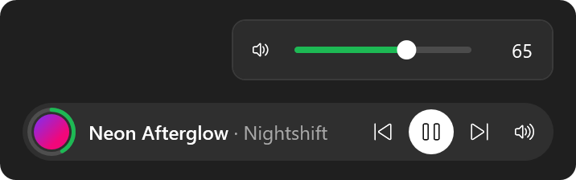
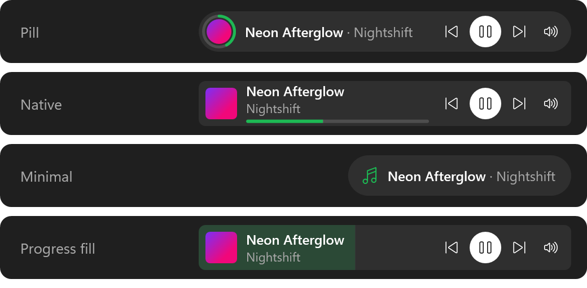
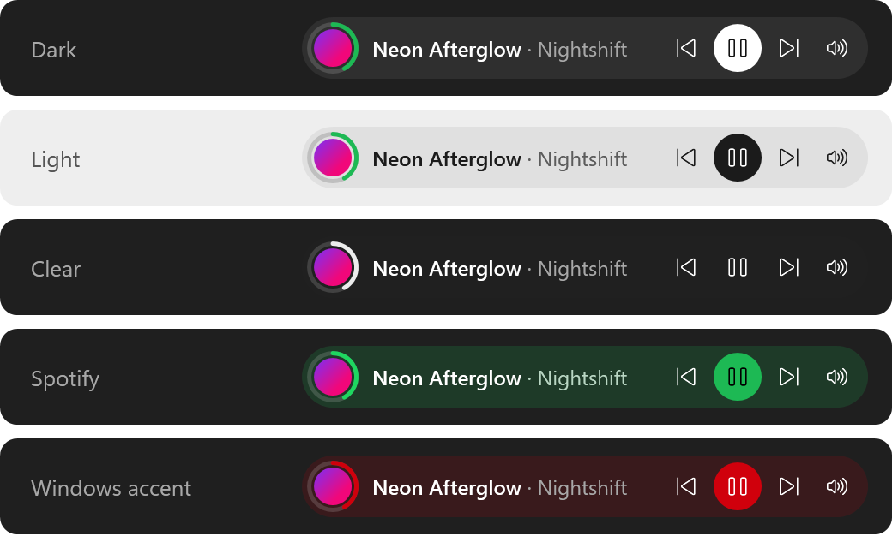
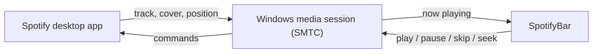

# SpotifyBar

**A tiny Spotify mini-player that lives right on your Windows 11 taskbar.**

See what's playing, pause, skip, scrub through the track, and change Spotify's volume without ever opening the Spotify window.


<p align="center">
  
  &nbsp;&nbsp;
  
</p>

## Features

- **Now playing at a glance**: title, artist, and round album art, right next to the system tray.
- **Progress ring**: playback progress is drawn as a ring around the cover.
- **Playback controls**: previous, play / pause, and next.
- **Seeking**: click anywhere on the ring to jump to that point, or scroll the mouse wheel over the widget to move ±5 seconds.
- **Spotify's own volume**: a speaker button opens a slider bound to the volume inside Spotify itself (the same slider you see in the app). Scroll over the speaker for 5% steps, or mute with one click.
- **Jump into Spotify**: click the track title to open it in the Spotify app, or click the artist to open their page. On tracks with several artists you pick which one.
- **Styles**: four layouts (Pill, Native, Minimal, Progress fill) that you can switch from the right-click menu.
- **Themes**: Dark, Light, Clear, Spotify green, or your Windows accent colour. Auto mode follows the Windows light / dark setting live. Any theme works with any style.
- **Lives on the taskbar**: drag it left or right along the taskbar to any free spot. It starts just left of the tray and never covers the tray icons.
- **Looks native**: a translucent pill that blends into the taskbar and highlights on hover like the taskbar's own buttons.
- **Stays out of the way**: hides automatically when a fullscreen game or video is in front, and comes back the moment the taskbar shows up (Start, tray, search).
- **Works without an account**: playback info and controls need no login. Connecting your Spotify account (one time, see below) adds volume and exact track / artist links.
- **Lightweight**: one small window with no taskbar button and no Alt+Tab entry. It never steals focus.

### Volume



### Styles

Right-click the widget → **Стиль** ("Style"):

- **Pill**: round cover with a progress ring.
- **Native**: square cover, title and artist on two lines, thin progress bar you can click to seek.
- **Minimal**: just a note icon and the track. The buttons appear when you hover.
- **Progress fill**: the whole widget fills up as the track plays.



### Themes

Right-click the widget → **Тема** ("Theme"). Your choice is remembered.



## How it works

Spotify's desktop app publishes its playback state to Windows through the
[System Media Transport Controls](https://learn.microsoft.com/uwp/api/windows.media.control) (SMTC), the same thing that powers the media flyout when you press a volume key.
SpotifyBar reads that session and sends commands back through it, so everything stays local to your PC.



The media session carries neither Spotify's volume nor track IDs, so those two features use the official
[Spotify Web API](https://developer.spotify.com/documentation/web-api) (`GET /me/player`, `PUT /me/player/volume`).
Sign-in uses Authorization Code with PKCE through a one-off loopback callback on `127.0.0.1:8888`, so no client secret is involved.
The refresh token is stored encrypted for your Windows user with DPAPI. Track and artist links open through `spotify:` URIs, which the desktop app handles.

Spotify only reports its position now and then, so SpotifyBar fills in the gaps between updates to keep the ring moving smoothly.
A window-event hook keeps the widget above the taskbar as soon as focus changes.

## Requirements

- Windows 10 version 2004 or later, or Windows 11
- [.NET 10 Desktop Runtime](https://dotnet.microsoft.com/download/dotnet/10.0)
- The Spotify desktop app
- For volume control: Spotify Premium (Spotify only allows changing volume through the API on Premium)

## Install

Build and install to `%LOCALAPPDATA%\Programs\SpotifyBar`:

```powershell
git clone https://github.com/DimaShevchenkoo/SpotifyBar.git
cd SpotifyBar
dotnet publish -c Release -r win-x64 --no-self-contained -p:PublishSingleFile=true -p:DebugType=none -o "$env:LOCALAPPDATA\Programs\SpotifyBar"
& "$env:LOCALAPPDATA\Programs\SpotifyBar\SpotifyBar.exe"
```

To start it with Windows, right-click the widget and check **Запускати з Windows** ("Start with Windows").

### Connect your Spotify account (for volume and links)

Spotify requires every app that uses its Web API to have its own Client ID, so you create one for yourself. It takes about two minutes:

1. Open the [Spotify developer dashboard](https://developer.spotify.com/dashboard) and click **Create app**.
2. Use any name and description. Under **Redirect URIs** add `http://127.0.0.1:8888/callback`, and under **Which API/SDKs** tick **Web API**. Save.
3. Copy the **Client ID** from the app's settings.
4. Right-click the widget → **Підключити акаунт Spotify…** ("Connect Spotify account"), paste the Client ID, and click **Увійти в Spotify** ("Sign in").
5. Approve access in the browser tab that opens. That's it.

Without a connected account, clicking the title or artist falls back to a Spotify search.

## Usage

| Action | How |
| --- | --- |
| Play / pause | Click the white button |
| Previous / next track | Click the arrows |
| Jump to a point in the track | Click on the progress ring (12 o'clock is the start), or on the bar in the Native style |
| Seek ±5 seconds | Scroll the mouse wheel over the widget |
| See elapsed / total time | Hover over the ring |
| Open the track in Spotify | Click the title |
| Open the artist in Spotify | Click the artist name |
| Change volume | Click the speaker and drag the slider, or scroll over the speaker |
| Mute Spotify | Click the speaker icon inside the volume popup |
| Change style | Right-click → **Стиль** |
| Change theme | Right-click → **Тема** |
| Move the widget | Drag it left or right along the taskbar. The position is remembered. |
| Menu: style, theme, Spotify account, autostart, reset position, exit | Right-click the widget |

The context menu and status text are in Ukrainian.

## Project layout

| File | What's inside |
| --- | --- |
| `MainWindow.xaml` | The pill layout: cover, progress ring, title, buttons, volume popup, context menu |
| `MainWindow.xaml.cs` | SMTC session handling, seeking, volume UI, track / artist links, positioning, fullscreen detection, autostart |
| `SpotifyApi.cs` | Spotify Web API client: PKCE sign-in, token refresh, player state, volume |
| `ConnectWindow.xaml` | The one-time "connect your Spotify account" dialog |
| `Themes.cs` | Theme palettes, Windows light / dark and accent colour detection |
| `Styles.cs` | The list of layouts |
| `AppSettings.cs` | All remembered settings in one JSON file, with migration from older versions |
| `Autostart.cs` | Start-at-logon via a Task Scheduler task, plus migration from the old Run-key entry |
| `App.xaml` | Theme brushes, round icon button styles, and the single-instance guard |

Everything you change is remembered and applied on the next start. Settings live in `%APPDATA%\SpotifyBar\`:
`settings.json` holds the theme, style, widget position, and the volume to restore after unmuting, and is saved right after each change.
`spotify.dat` holds the encrypted Spotify sign-in.
Autostart is a per-user Task Scheduler task named `SpotifyBar` that runs at logon. The `HKCU\...\Run` key turned out to be
skipped silently by Explorer on recent Windows 11 builds, so older installs are migrated to the task automatically.

## License

[MIT](LICENSE)
